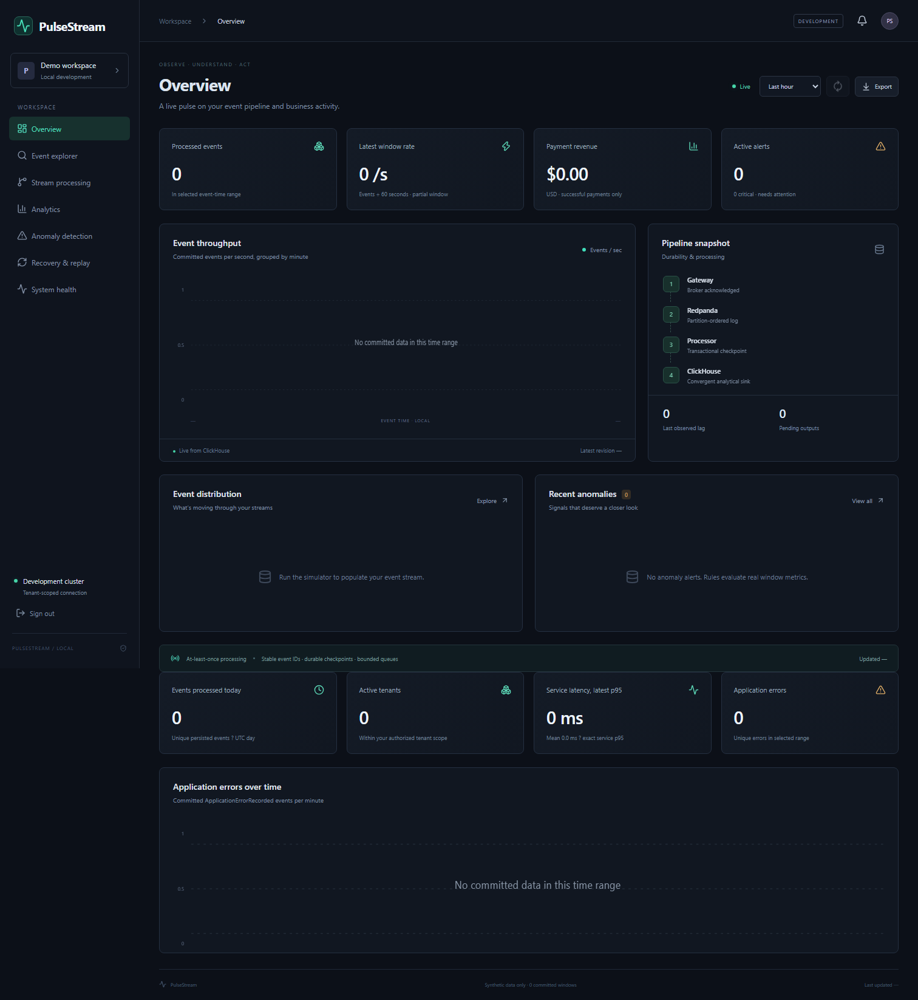
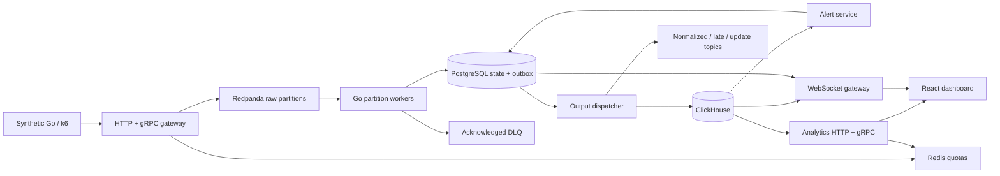
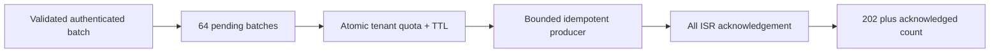
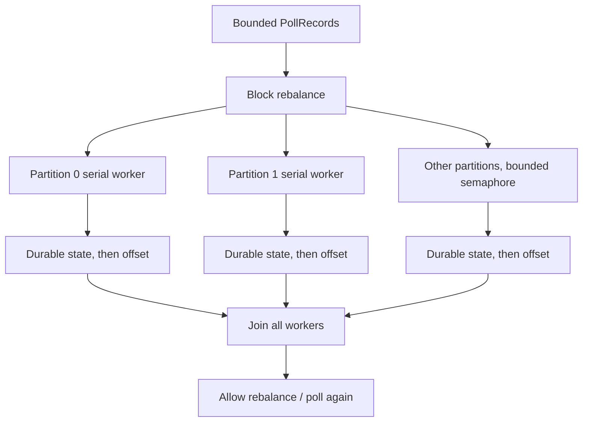
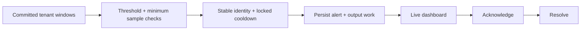
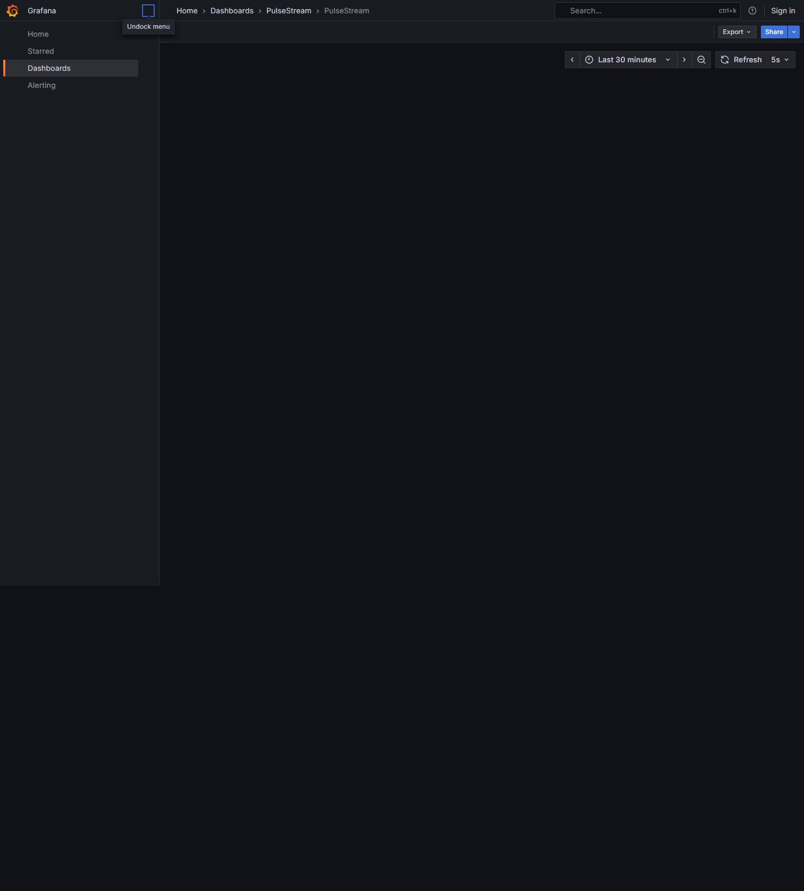

# PulseStream

Distributed real-time event processing and analytics in Go, using Redpanda, ClickHouse, PostgreSQL, Redis, gRPC and Kubernetes. PulseStream processes synthetic e-commerce/payment activity with partition-aware execution, bounded concurrency, event-time windows, replay-convergent outputs and observable recovery.

This repository contains running services and executable correctness tests. The local topology is a development environment; it does not claim global exactly-once delivery, multi-broker availability or unmeasured throughput. [Verification evidence](docs/verification.md) and [known limitations](docs/limitations.md) distinguish implemented behavior from deployment assumptions.



## What it does

- HTTP and protobuf gRPC ingestion with tenant API keys, role checks, strict validation, quotas, bounded admission and broker acknowledgements.
- Redpanda/franz-go publishing and consumer groups; stable tenant/entity partition keys and serial execution inside each partition.
- Four Go event-time window specifications, exact active users and service-latency quantiles, integer currency totals, late corrections and bounded state.
- PostgreSQL transactions coupling checkpoint, deduplication, watermark state and durable output work; ClickHouse versioned shard snapshots with `FINAL` reads.
- Acknowledged DLQ handling, bounded dry-run/corrected replay, audit history and six configurable anomaly rule families with acknowledgement/resolution.
- Seven React/TypeScript operational pages, authenticated reconnecting WebSockets, event explorer and real report export.
- Prometheus, provisioned Grafana, OpenTelemetry span links, JSON logs, Compose, Helm, Kubernetes resources and opt-in Kafka-lag KEDA configuration.

## Architecture



One backend image runs six independent roles: ingestion-gateway, stream-processor, sink-dispatcher, analytics-api, alert-service and websocket-gateway. `init` provisions local schemas/topics/rules. Shared Go packages contain immutable contracts and implementations; mutable window state belongs to one partition transaction. PostgreSQL is authoritative; Redis is supporting infrastructure.

| Component | Implementation |
|---|---|
| Backend | Go 1.26, franz-go, pgx, grpc-go, protobuf/Buf |
| Log / analytics / state / cache | Redpanda, ClickHouse, PostgreSQL, Redis |
| UI | React, TypeScript, Vite, WebSockets, native SVG charts |
| Observability | Prometheus, Grafana, OpenTelemetry OTLP collector |
| Packaging / verification | Docker Compose, Helm, Kubernetes, KEDA configuration, k6, Go race tests, Testcontainers, Playwright, GitHub Actions |

Versions are pinned in module/npm lockfiles and container tags. The executed Go toolchain was `go1.26.11 linux/arm64`. See [architecture](docs/architecture.md) and the [decision records](docs/adr).

## Run locally

Requirements: Docker Desktop/Engine with Compose v2 and Python 3. The task runner uses containerized Go/Node/Helm, so host Go and Node installations are optional. Allocate sufficient Docker memory; this run used a VM with about 7.55GiB and eight CPUs.

```bash
cp .env.example .env
docker compose up --build -d --wait --wait-timeout 180
docker compose ps
python3 scripts/tasks.py seed
```

PowerShell:

```powershell
Copy-Item .env.example .env
docker compose up --build -d --wait --wait-timeout 180
docker compose ps
python scripts/tasks.py seed
Start-Process http://localhost:13000
```

Open **[dashboard](http://localhost:13000)** and use the development key **`demo-key`**. `reader-key` is a tenant-scoped read-only identity. [Grafana](http://localhost:3001/d/pulse/pulsestream) permits local anonymous viewing; development admin login is `admin` / `pulse-dev`. [Prometheus](http://localhost:9095/targets) shows scrape targets.

| Endpoint | Local address |
|---|---|
| Ingestion HTTP / gRPC | `http://localhost:18080` / `localhost:19090` |
| Analytics/admin HTTP / gRPC | `http://localhost:18081` / `localhost:19091` |
| WebSocket gateway | `ws://localhost:18082/ws` (dashboard proxies `/ws`) |
| Redpanda Kafka / metrics | `localhost:19092` / `http://localhost:9644` |
| ClickHouse / PostgreSQL | `localhost:8123` / `localhost:5432` |

The HTTP/dashboard ports avoid other containers already running on the development machine. No unrelated containers are stopped. Local credentials are public samples, and all exposed host ports bind to loopback. See [security boundaries](docs/security.md).

Ordinary startup does not generate traffic. `seed` sends 1,000 finite synthetic events. A larger simulation is explicit:

```bash
python3 scripts/tasks.py generate-events --count 100000 --rate 1000
docker compose --profile simulation run --rm event-generator \
  -url http://ingestion-gateway:8080/v1/events \
  -count 10000 -rate 1000 -seed 9002 -anomaly
```

The simulator supports deterministic seeds/base times, finite count/duration, bounded producer workers, payload padding, late arrivals, key cardinality, weighted event-type lists and traffic-spike options. Use `-help` for exact flags. For multiple tenants, provision `PULSE_KEYS` entries and pass both `-tenants` and corresponding `-tenant-keys`. Reusing a seed/tenant/index produces the same event IDs and intentionally exercises deduplication; choose a new seed for additional independent data.

Stop with `docker compose down`; named data volumes remain. `docker compose down --volumes` permanently deletes this project's broker/database state and is an explicit reset, not ordinary shutdown.

## API example and tenant setup

```bash
python3 scripts/publish_example.py
curl -H 'Authorization: Bearer demo-key' http://localhost:18081/v1/metrics
curl -H 'Authorization: Bearer demo-key' http://localhost:18081/v1/groups
```

`publish_example.py` creates a current synthetic payment and prints the broker acknowledgement plus stable retry ID. Event contracts live in [protobuf](api/proto/pulse/v1/pulse.proto), [OpenAPI](api/openapi/pulse.json), and [event-model documentation](docs/event-model.md). [API reference](docs/api.md) covers batches, filters, errors, roles, window selection, WebSockets and bounded replay. Analytical SQL is parameterized; callers cannot submit arbitrary SQL.

The development tenant is configured through keys and seeded by `init`. To add a tenant, append a new `key:tenant:role` entry to `.env`, set optional `PULSE_TENANT_RATES`, recreate application services and rerun `docker compose run --rm init`. A key always belongs to one tenant. There is no unauthenticated tenant-creation API.

## Ordering and backpressure

Kafka keys are `tenant_id/partition_key`. Related business events must share that key, with a fixed partition count. Kafka provides ordering within a partition; there is no global event order.





Polling stops while fetched work remains unfinished. Retries wait with cancellation. Window/cardinality/checkpoint limits and the outbox backlog limit pause processing instead of dropping accepted events. WebSocket clients have bounded outbound queues and write deadlines. Shutdown cancels incomplete transactions so they can be retried, preserving committed output work. [Concurrency details](docs/partitioning.md).

## Window and storage semantics

Go implements 1m and 5m tumbling windows, 5m hopping windows at 1m steps, and 15m hopping windows at 5m steps. Watermarks track maximum partition event time minus 10s; allowed lateness defaults to 2m. Closed windows accept corrections until final. Too-late events remain queryable but do not alter totals. Global finality conservatively includes idle/unseen partitions. [Exact policies and rate denominators](docs/windowing.md).

```mermaid
sequenceDiagram
  participant Kafka
  participant Worker
  participant PG as PostgreSQL
  participant Dispatcher
  participant CH as ClickHouse
  Kafka->>Worker: ordered partition batch
  Worker->>PG: lock checkpoint; dedup + state + outbox
  PG-->>Worker: transaction committed
  Worker->>Kafka: commit completed prefix
  Dispatcher->>PG: bounded outbox selection
  Dispatcher->>CH: versioned batched inserts
  CH-->>Dispatcher: acknowledged
  Dispatcher->>PG: remove acknowledged output work
  Note over Worker,CH: crash retries converge via checkpoints, IDs and versions
```

Kafka offsets advance after required effects are **durably staged in PostgreSQL**, potentially before ClickHouse visibility. ClickHouse stores immutable events and cumulative, offset-versioned per-partition window snapshots using ReplacingMergeTree. Application reads use `FINAL`; retry duplicates may exist physically without inflating logical counts. Exact user unions and histograms merge across latest shards. Monetary totals stay integer and separate currencies. [Consistency protocol](docs/consistency-model.md), [checkpointing](docs/checkpointing.md), [table design](docs/clickhouse.md).

## Anomalies, DLQ and recovery demonstration



The six rule families cover payment failures, traffic spikes, revenue drops, application errors, service p95 and account bursts. Enable flags, thresholds, sample counts, severity and cooldowns are editable. Alert identities remain stable across replay. [Rule definitions](docs/anomalies.md).

```bash
python3 scripts/tasks.py e2e --count 100000 --rate 1000
python3 scripts/tasks.py failure-test
```

The first command publishes 100,000 events through public APIs, checks complete event-type totals and compares Go window count/revenue with an independent ClickHouse scan. It also tests tenant/role rejection, generated gRPC clients, committed WebSocket frames and real anomaly alerts. The failure script stops/restarts only PulseStream services, ingests during processor downtime, verifies recovery and duplicate convergence, interrupts ClickHouse/Redis/the broker, scales processors to trigger rebalance, sends an invalid broker record, inspects its DLQ envelope and replays a validated schema-version correction. It asserts results before writing evidence.

Replay always requires explicit partition/offset bounds, maximum scan/match limits and an admin key. Publication requires confirmation; dry-run inspection publishes nothing. Stable IDs suppress existing effects. [Recovery and replay details](docs/recovery.md).

Dashboard pages cover Overview, Event explorer, Stream processing, Analytics, Anomaly detection, Recovery & replay and System health. Export produces a JSON report of actual ClickHouse window data and persisted alerts. [Additional real screenshots](docs/screenshots).



## Tests, measurements and automation

```bash
python3 scripts/tasks.py build
python3 scripts/tasks.py test
python3 scripts/tasks.py test-race
python3 scripts/tasks.py test-integration
python3 scripts/tasks.py frontend
python3 scripts/tasks.py lint
python3 scripts/tasks.py helm-lint
python3 scripts/tasks.py benchmark
```

On PowerShell use `python`. Every Makefile target delegates to the same cross-platform runner; on Windows with Make, set `PYTHON=python`. Unit/property tests exercise schema checks, membership, reference totals, late correction, finalization, money, quantiles, admission pressure, rule behavior, deterministic generation and bounded range validation. Integration tests use real Compose services; an opt-in Testcontainers test provisions a fresh Redis instance. Recovery tests assert checkpoint integrity, duplicate suppression, sink retry convergence, concurrent partitions and no checkpoint advancement before DLQ acknowledgement. The race detector and a broker-client goroutine-leak check run on Linux containers. For optional browser verification, install `playwright` with pip, run `python -m playwright install chromium`, then `python scripts/screenshots.py` against the running stack.

Executed observations:

| Measurement | Observed result |
|---|---|
| 100k public API demonstration | Final run passed; 102.900s through durable visibility, 971.8 events/s including pacing/drain |
| 10k-event ingestion run, target 1k/s | 10,000 acknowledged, 0 failed; 1,009.43 acknowledgements/s |
| 10k-event ingestion burst, target 10k/s | 10,000 acknowledged, 0 failed; 10,059.05 acknowledgements/s; batch p50/p95/p99 6/25/39ms |
| Million-event CPU/window test | Passed exact count and revenue reference; 13.54898s; not distributed throughput |
| Fault suite | Processor, sink, Redis, rebalance, DLQ/replay and broker-outage assertions passed |
| Frontend | Production build and three data tests passed; npm audit: 0 vulnerabilities at scan time |
| Kubernetes | Real Kind deployment passed count/revenue/failure, group, alert lifecycle and browser WS checks; Helm/schema validation passed |

[Full performance report](docs/performance.md), [raw evidence](docs/evidence), [verification ledger](docs/verification.md). Configured 50k/100k event rates are targets, not achieved sustained capacity. The 100k/s overload burst produced explicit rejections and a nonzero generator exit. No per-event end-to-end latency distribution or production SLA is invented.

GitHub Actions includes formatting, vet, race tests, real-service integration/E2E/failure checks, Testcontainers, frontend build/tests/audit, Buf generation checks, Go vulnerability scanning, Helm validation and backend/dashboard image builds. CI configuration is provided; a remote GitHub Actions run is not claimed.

## Kubernetes and operational boundaries

```bash
python3 scripts/tasks.py helm-lint
python3 scripts/tasks.py kind-deploy
# Requires kind, kubectl and helm on PATH.
```

The chart supplies probes, resource limits, non-root backends, configuration/Secret references, Services, optional TLS Ingress, NetworkPolicy and KEDA Kafka-lag configuration capped to partition parallelism. Dependencies are explicit and stateful. [Deployment and teardown commands](docs/kubernetes.md) distinguish local single-replica infrastructure from production requirements. [Observability](docs/observability.md) describes metrics and asynchronous trace links.

Known boundaries include conservative idle finality, capped exact state, eventual analytical visibility, unexpired PostgreSQL deduplication, synchronous bounded replay, fixed adjacent-window anomaly baselines, public development credentials, absent Kafka TLS/SASL/JWT/mTLS, and unverified multi-node/KEDA failover. Read [the complete limitations list](docs/limitations.md) before exposing the system or changing consistency-sensitive code.

## Repository map

```text
api/           protobuf sources, generated Go clients, OpenAPI JSON
cmd/           pulsestream runtime, finite event generator, replay CLI
internal/      api, app, config, event, broker, processing, windows,
               store, sink, analytics, anomaly, cache, observe, synthetic
web/           React + TypeScript dashboard, Nginx image, data tests
deployments/   Docker config, Helm, Kubernetes, Prometheus, Grafana, OTLP
tests/         real-service integration, recovery/property checks, E2E
scripts/       cross-platform tasks, failure assertions, screenshots, profiling
benchmarks/    k6 constant-arrival workload
docs/          engineering policies, ADRs, screenshots, measured evidence
.github/       verification and image-build workflows
```

Future improvements: durable-state throughput, typed ClickHouse snapshots, end-to-end latency instrumentation, durable replay jobs, broader rule selectors, tested transport security and multi-node failure drills. Contributions must preserve the documented checkpoint/offset contract and include executed evidence for changed guarantees. MIT licensed.
