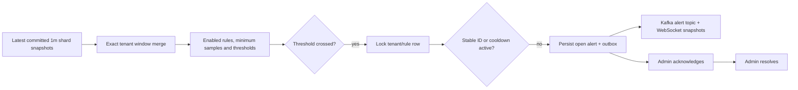

# Rule evaluation and alert lifecycle

Rules evaluate real committed one-minute aggregates every two seconds, over the last hour. Provisional windows may trigger alerts; evidence identifies whether global finality was established. The system does not retract an alert if a late correction later removes its threshold violation. Acknowledge/resolve are explicit operator lifecycle actions.

| Kind | Observed value | Default threshold |
|---|---|---|
| payment_failure | Failed / (successful + failed), with >=20 terminal payments | >0.30 |
| traffic_spike | Current count / preceding adjacent minute count; baseline >=100 | >3x |
| revenue_drop | 1 - current USD revenue / preceding adjacent minute USD revenue | >0.50; previous successes >=20 |
| error_rate | Largest service error fraction among services with >=20 observations | >0.10 |
| latency | Exact service latency p95; >=20 service latency samples | >1500ms |
| account_burst | Maximum account event count within the minute | >100 |

Every rule also requires the total window count to meet `min_samples`. Rules have independent enable flags, threshold, sample count, severity and cooldown seconds. Default cooldown is 300s. Revenue-drop currently uses USD explicitly, and the account-burst rule counts all event types. Other currency-specific baselines or per-event-type account rules require an extension. Baselines use adjacent window comparisons, not a learned forecasting model. This is rule-based monitoring, not a fraud classifier.

IDs hash pipeline, tenant, rule and window start. A unique alert primary key plus a locked rule row enforces duplicate suppression and cooldown across alert replicas. Alert output is staged in the same PostgreSQL transaction as the alert. ClickHouse history is versioned; PostgreSQL remains authoritative for lifecycle state. Alerts retain triggering count, payment counts, shard count, pipeline, observed value, threshold, severity and timestamps. Updates never reopen an already resolved alert.
