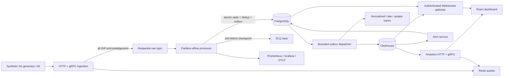
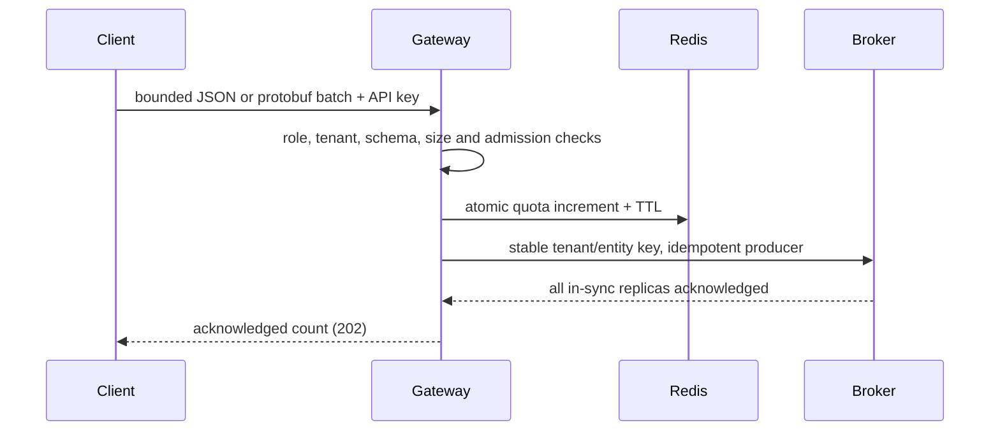

# Architecture and ownership

PulseStream is a Go monorepo with one backend image and six independently deployable runtime roles. The `init` role provisions topics, PostgreSQL tables, ClickHouse tables, and six tenant rule defaults. It is a bounded one-shot operation. The simulator never starts with ordinary `compose up`.

The processor owns event validation, deduplication and aggregate evolution. PostgreSQL owns durable state. The dispatcher owns external delivery. The alert service owns rule evaluation; alert transitions use row locks and stable identities. HTTP APIs authorize every tenant filter. WebSockets independently read confirmed ClickHouse data and authoritative alert state. They never expose uncommitted in-memory window changes.

The local broker has **one replica**. `acks=all` therefore acknowledges one broker, not a multi-broker quorum. Redpanda's local write caching is enabled; this setup demonstrates broker acknowledgement and process recovery, not power-loss survival or highly available infrastructure. Production operators must choose replication, minimum ISR, write-cache/fsync policy, retention, TLS and SASL explicitly.

The design follows the actual [franz-go consumer API](https://pkg.go.dev/github.com/twmb/franz-go/pkg/kgo) and [ClickHouse ReplacingMergeTree behavior](https://clickhouse.com/docs/engines/table-engines/mergetree-family/replacingmergetree). See [consistency protocol](consistency-model.md), [window semantics](windowing.md), and [limitations](limitations.md).
