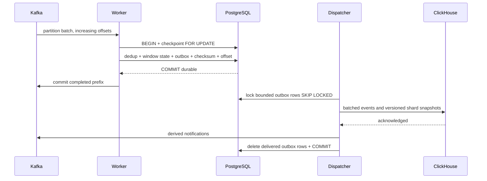

# At-least-once execution and convergent effects

Each raw partition batch takes a PostgreSQL checkpoint row lock. The transaction verifies the configuration fingerprint and state checksum, skips offsets already recorded, enforces an increasing contiguous raw-input prefix, inserts `(pipeline, tenant, event_id)` into durable deduplication, evolves window state, and records output rows. It commits these effects together before Kafka offsets are committed.

Required effects at an input-offset commit are **durably staged** outputs. ClickHouse visibility can lag that commit. An acknowledged ingestion event may still be in Kafka, processing, or the outbox. The UI reports confirmed sink rows, not acceptance as processing completion.

| Crash boundary | Recovery |
|---|---|
| Before state transaction commits | PostgreSQL rolls back; Kafka redelivers |
| After state commit, before Kafka offset commit | Redelivery finds checkpoint prefix and makes no duplicate effects |
| After ClickHouse insert, before outbox deletion | Dispatcher repeats physical rows; version-aware queries converge |
| While some ClickHouse tables succeeded | Whole outbox selection retries; prior rows remain logically idempotent |
| Before DLQ acknowledgement | State transaction rolls back, poison offset stays uncommitted |
| After DLQ acknowledgement, before checkpoint | DLQ may repeat with the same source identity |

ClickHouse `ReplacingMergeTree(version)` does not immediately eliminate physical duplicates. All application analytical reads use `FINAL`. Window identifiers include pipeline, tenant, specification, start, and input partition. The version is the largest contributing input offset plus one **within that partition**. Older shard snapshots cannot replace newer revisions. Snapshot counts are replaced, never additively applied on delivery.

Distinct users and latency histograms are merged across latest shard snapshots in Go, so summing per-partition distinct counts cannot inflate tenant users. Integer revenue is grouped by currency. Configuration changes require a new pipeline/consumer-group namespace and an explicit source rebuild. Do not delete a checkpoint while retaining Kafka commits; that can skip state reconstruction. Restore PostgreSQL from consistent backup, or use a fresh group and output namespace.

Deduplication records are retained durably without automatic expiry. Reusing an event ID with altered content has first-committed-value semantics. Deleting deduplication records weakens replay guarantees and is an explicit administrative maintenance decision. Kafka retention is seven days locally; source loss beyond retention is not recoverable through application logic. Offset gaps fail closed.

This is not an atomic distributed transaction over Kafka, PostgreSQL and ClickHouse. There is no global exactly-once or cross-partition atomic snapshot claim. Alerts and window tables may become visible at different moments.

Publication waits are capped at 30s through buffered, per-batch callbacks. A caller deadline can precede the final Kafka outcome; stable IDs handle a later delivery plus client retry. The callback result channel has one slot per record so late completion cannot block producer internals. DLQ/checkpoint and outbox removal still require observed successful acknowledgements.
