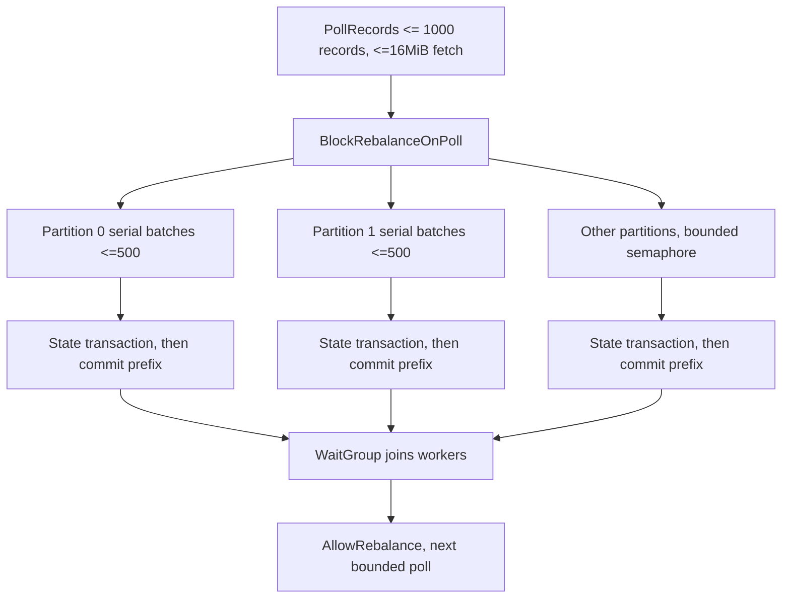

# Partitioning and bounded execution

Raw keys are `tenant_id + '/' + partition_key`. Keys use validated identifiers without slash ambiguity. Producers must choose the same business entity key for related events; partition count must remain fixed for a pipeline lifetime. Changing it can move keys and invalidate existing affinity assumptions. The synthetic generator assigns accounts; its event-type mix is deterministic for a seed/base time and covers all 13 schemas. Orders are illustrative, not a full payment-provider state machine.

At most `PULSE_PARTITIONS` partition goroutines run per poll; a partition executes serially and owns no shared mutable Go state. PostgreSQL serializes its state transitions across process restarts and overlapping group generations. Offset commits occur after durable transitions, only through the completed per-partition prefix. Raw topics are uncompacted and the implementation fails closed on offset gaps, including retention that overtakes an unprocessed checkpoint.

Polling does not continue while a fetched batch is unfinished. Kafka heartbeat/network goroutines belong to franz-go, with bounded fetch bytes and record buffers. Rebalances are blocked while processing, and `AllowRebalance` follows the worker join. On cancellation, incomplete PostgreSQL transactions roll back; previously committed outbox work remains durable. A long dependency outage can exceed group rebalance deadlines; reassignment redelivers from the committed prefix and row locks plus checkpoints suppress repeat effects. There is no total ordering across partitions.

Retries wait one second with context cancellation. The durable output backlog is limited at 500,000 rows; transactions crossing the threshold roll back and pause progress. The count-based limit is approximate under concurrent transactions and may overshoot by concurrently committing batches. Monitor disk too. The dispatcher selects 500 rows, holds locks until destinations acknowledge, and waits 50ms between selections. HTTP listeners cap connections at 128 per role, and a 16-request admission gate runs before JSON body decoding. Publication separately allows 64 pending batches. gRPC caps connections at eight and concurrent streams at two per connection, with 4MiB receive messages. These finite bounds must be sized alongside container memory and payload sizes. WebSockets allow 64 connections per replica, four outbound frames each, five-second writes, and slow-client eviction. These limits are configuration and operational constraints, not throughput claims.
