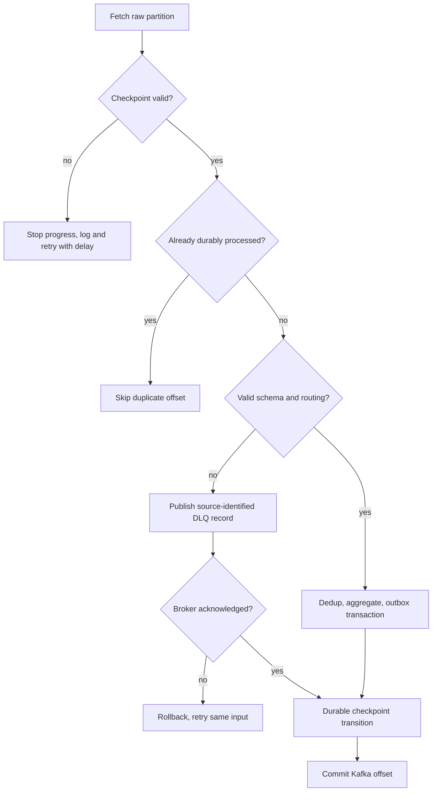

# Recovery, DLQ and replay

Permanent schema failures and unsupported versions go to `pulsestream.events.dlq.v1`; routing-key mismatch is an invalid schema/routing failure. DLQ envelopes include base64 original bytes, source topic/partition/offset, category, stage, attempt count, safe details, failure time and tenant. Source identity remains stable across repeated DLQ delivery. Details do not echo secrets or validation payloads. Invalid JSON with no recoverable tenant is not visible to tenant-scoped DLQ inspection; inspect it with trusted broker tools.

Database/broker outages and state-capacity/checksum failures retry with backpressure; there is deliberately no infrastructure retry-exhaustion path that drops valid data. Too-late valid events go to `pulsestream.events.late.v1`, remain queryable with `late=1`, and never inflate window totals.

Replay requires an admin key, topic from a fixed allowlist, a single partition, explicit inclusive start/exclusive end offsets, at most 10,000 scanned offsets and 1,000 matches. Dry runs publish nothing and return at most 100 records. Publication requires `confirm=true`. Optional category and event-time filters operate **within** the bounded offset range. Kafka timestamps are admission times; they cannot directly locate arbitrary event-time ranges for late sources. Broader event-time replay requires operator-selected offset ranges or an external index.

`set_schema_version: 1` is a narrow correction policy for unsupported-version records whose remaining schema already validates. It is not arbitrary JSON patching. Other invalid payloads require fixing the source data and submitting a valid stable ID. Replayed events are revalidated and published to raw with the same event ID. Same-namespace deduplication prevents duplicate business effects. A previously classified late ID remains deduplicated: backfill with changed lateness requires a new pipeline namespace and a full source rebuild, not selective corrections in existing finalized windows.

`replay_audit` records request, caller tenant, state, published count, sanitized error and completion time. Replay is synchronous with bounded request deadlines; a process crash can leave audit status `running`. Inspect broker state and retry the bounded request using stable IDs. There is no asynchronous durable job scheduler or automatic correction of abandoned audit entries.

Run `python scripts/failure_test.py` against the local stack to assert processor recovery, duplicate convergence, ClickHouse outage recovery, Redis fail-closed behavior, consumer scale-out, acknowledged DLQ + corrected replay, and broker-outage rejection. It restores stopped dependencies and scales back to one processor. It writes evidence only after assertions pass.
